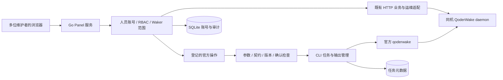

# 官方操作与原有 Panel

“官方操作”页按功能分组接入 QoderWake CLI 的完整命令树。目标参考为国际版 1.1.13；当前登记 373 个可执行操作，每项提供参数表单、权限检查、执行结果和官方帮助。逐项清单见 [CLI 覆盖表](cli-coverage.md)。

原有聊天、模型 / Provider、机器人、记忆、用量、安全、网络、插件、API 网关、增强管理、IM 通道、运行管理、会话管理与技能编辑继续保留。工作台集中展示实例状态、可维护的 Waker 和最近变更；导航按维护资源、运行与观测、系统管理分组。日常列表、分页和已有编辑页沿用 HTTP 与现有专用适配；新增命令在用户选择并提交时启动官方 CLI，不以后台轮询启动大量 CLI 进程。

## 架构



Go 负责权限、任务与 SQLite，React 负责参数表单和结果展示。macOS 与 Linux 使用同一操作层，CLI 路径和 HOME 由启动配置指定。平台进程与服务控制使用各自适配器。

## 使用

1. 在“官方操作”左侧选择项目、MCP、配置、群协作、SOP、自动化、记忆、WakerFlow 等分组，或搜索中文动作名、命令名。
2. 在右侧填写参数。位置参数按顺序填写；可选参数填写时自动勾选，也可单独勾选以提交空值。取消勾选后省略该参数，使用官方默认行为。多值参数每行一个值，也可用 JSON 字符串数组保留值内换行与排列顺序。
3. Waker 配置和已有技能修改先“读取当前版本”。发生冲突后重新读取并合并；工作台不会覆盖当前版本。
4. 读取操作直接提交。写入、安装、升级、外发、运行和本地文件输出等操作显示确认。官方的 `--dry-run`、`--apply`、`--yes`、幂等键等仍作为各命令独立参数，Panel 不统一追加。
5. 在“执行结果”查看输出、退出码和状态。离开页面后任务继续；可从“我的操作记录”返回。需要持续跟随的命令，可在“执行设置”调整最长等待时间。

Waker 删除在提交时打开原有依赖预检；技能回滚使用原有版本与只读技能检查。它们不能通过直接请求原生执行接口绕过这些流程。其他现有编辑页的功能及接口保持原样。

新增 MCP 时，先选择“填写配置”“导入 JSON”或“导入 JSON 文件”。填写配置再选择 HTTP、SSE 或 stdio，对应字段会随选择展开；切换方式后，隐藏的无关参数不参与提交，已填写内容仍保留到切回该方式。“全部参数”提供完整契约字段。请求头与 OAuth、版本与幂等参数、执行设置分别展开。

切换操作、离开页面或退出账号时，有尚未执行的表单会提示确认。命令成功提交后可继续查看输出；再次执行仍需核对当前参数。

## 交互、运行上下文与文件

浏览器登录、终端确认等命令可启用交互终端，在输出窗口下方输入响应。`proxy set --stdin` 等命令可填写标准输入。终端输入、凭据参数和输出正文均不写入操作审计；输出常见凭据字段被遮蔽。

`atwaker`、`todo`、`goal` 等运行内命令需要当前官方 Run 上下文。管理员在执行设置中填写现有 Conversation / Run / Participant 标识和 Run 凭据。Panel 不从宿主环境继承其他 Agent 的运行身份，也不创建或伪造 Run 凭据；官方继续验证其有效期、范围和目标绑定。

文件参数可以使用宿主机路径。管理员也可直接上传文件，或先填写输出文件名，再选择“保存为可下载文件”。文件引用仅在当前账号的临时文件目录中解析；结果文件生成后可下载，并用“清理”移除。单文件上限为 64 MiB。目录输入、超出该限制的文件仍使用宿主机路径；这些文件由官方命令在宿主机处理。

## 权限与操作记录

管理员可使用全部已登记功能。维护者与观察者只看到登记到其 Waker 范围的操作；维护者可以修改相应配置与技能，观察者只读。全局设置、共享资源、权限提升、插件安装、外部执行、账号及运行上下文由管理员操作。

范围检查使用明确的 `--waker-id`；受限账号不能加入兼容别名、公共项目开关、任意 JSON / 本地文件输入等改变作用域的参数。输出与文件下载也重新验证当前人员身份。禁用账号或改变权限会撤销已有会话。

任务记录保存在 `QW_ROOT/native-operations/operations.db`，包含主体、操作标识、资源范围、时间、状态与退出码。参数、正文、交互输入和终端输出不存入该数据库。相同请求标识的重试返回已有任务；结果未知的写请求不换通道、不自动重发。

输出在当前 Panel 进程中保留最近 2 MiB；重启后可查元数据，输出正文不可恢复。Panel 停止、等待超时或手动停止写命令后，已提交给 daemon 的动作可能继续，状态显示“结果待核对”。取消官方 Run 应使用对应的 `runs cancel`、`workflow run-terminate` 或其他明确命令。

## 版本适配与验证

打开操作时会读取当前二进制的对应 `--help`，对照登记的参数参考。不存在或发生变化的命令显示具体原因并停止执行；不会向旧版本盲目发送新版参数。Linux 使用相同检查，因此需要对应版本的实机验证。

升级命令参考时，在目标实例运行只读采集器，审查新增操作、参数和权限，再更新 `panel/config/cli-reference.json`、`cli-policy.json` 及覆盖清单：

```bash
python3 scripts/collect_cli_reference.py /path/to/qoderwake /tmp/cli-reference.json
```

采集器只运行 `--help` / `--version`。测试覆盖命令树完整性、JSON 输入与输出参数的区别、重复参数、命令注入边界、角色与资源范围、幂等记录、持续输出、交互输入、未知结果及文件隔离。真实实例验证另记录在交付材料；未执行生产安装、删除、外发、升级或模型消费来探测能力。
