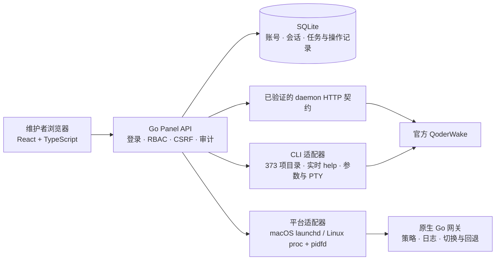

# React 与 Go 迁移

0.13 使用 Go 服务和 React 界面，保留 Panel 功能、国际版 1.1.13 的 373 项 CLI 操作、人员账号与 Waker 范围权限。发布目标为 macOS arm64 和 Linux amd64。

## 保留与替换

- 保留现有 `/api/` 行为、SQLite 数据、账号 scrypt 格式、会话撤销、审计、版本冲突和删除预检。
- 保留命令目录与权限规则 JSON，继续在执行前核对官方 CLI 契约。
- React 接管组件、路由、表单及请求状态；Go 接管服务、数据库、任务与平台控制。
- 迁移期间保留 Python 和旧前端作回归对照；正式切换前完成逐项覆盖。旧实例与新实例使用独立数据目录，避免双写。
- 官方 QoderWake 仍为外部依赖。平台相关进程、凭据与启动逻辑分别验收；主服务编译成功不能替代平台验收。

## 实施与完成条件

| 阶段 | 内容 | 完成条件 |
| --- | --- | --- |
| 基础 | Go 服务、SQLite 兼容、账号与权限、React 工程 | 旧格式账号与角色兼容；会话、CSRF、撤权和并发变更测试通过 |
| 维护工作区 | 首页、Waker、Skill、配置、人员、审计 | 现有编辑、版本、差异、回滚和草稿处理完整；两个账号协作验收 |
| 完整能力 | CLI 目录、表单、任务、文件与剩余旧页面 | 373 项参数完整；权限、确认、幂等、未知结果与删除预检保持 |
| 平台与交付 | 静态资源嵌入、运行入口、Mac/Linux 适配 | 两平台构建；Mac 实机运行；Linux 实机或等价运行验证；迁移与回退演练 |

前端依赖在开发机安装并锁定；目标机器加载嵌入 Go 的静态资源。Go 使用纯 Go SQLite 驱动，避免要求目标机安装数据库服务或 C 工具链。界面沿用当前工作台视觉，在新组件中承接现有交互。

## 架构与协作边界



React 负责页面、表单、草稿和请求状态；Go 负责权限裁决、配置变更、任务与进程管理。常用资源页面继续使用已验证的 daemon HTTP 契约；完整官方能力由 CLI 适配器承接，执行前读取当前二进制的 help 并核对参数。Panel 对浏览器提供的 HTTP API 与访问官方 daemon 的 HTTP 适配器是两个边界。

多用户登录使用本地账号，管理员分配角色与 Waker 范围，不依赖 SSO。所有入口在 Go 层核验权限，修改资源时刷新身份并检查版本。多个 Panel 用户共享所连接的官方实例与运行账户；Panel 的 RBAC 不提供独立 OS 账户或独立官方租户。需要系统层隔离时使用独立实例与数据目录。

完整页面与旧接口的映射见 [能力与接口覆盖](react-go-capabilities.md)。

本文件说明架构和迁移方式。当前版本的检查结果及限制见 [0.13 发布说明](releases/0.13.0-rc.1.md)。

## 开发入口

新实现位于 `cmd/panel`、`internal/` 和 `web/src`。旧 `panel/*.py` 与 `panel/static` 暂作兼容对照；React 复用现有主题 CSS，页面交互由组件管理。

```bash
# 在 qoderwake-panel 目录运行，生成当前平台的独立候选。
bash scripts/build-go.sh

# 初始化专用开发数据目录后启动。
build/panel-darwin-arm64 init-admin --root /path/to/dev-data --username owner
build/panel-darwin-arm64 serve --root /path/to/dev-data --home /path/to/qoderwake-home \
  --daemon-bin /path/to/qoderwake --daemon-url http://127.0.0.1:19820

# 开发检查。
go test -race ./internal/...
npm --prefix web test
npm --prefix web run check
```

`GOOS=linux GOARCH=amd64 bash scripts/build-go.sh` 构建 Linux x64。构建机需要 Go 与 Node；生成的 Panel 程序包含前端资源和 SQLite 驱动。

## 原生服务配置

`service-config` 生成当前 Panel 二进制的用户服务配置。新建实例只需 Panel 和官方 QoderWake；已有 schema1 Linux 网关继续使用下文的 Python 兼容组件。账号先用 `init-admin` 初始化。输出文件使用新建模式，已有服务配置会被保留。端口、数据目录和 daemon 地址应与待管理的实例对应。

macOS 使用 LaunchAgent：

```bash
panel service-config --root "/path/to/panel-data" --home "/path/to/qoderwake-home" \
  --daemon-bin "/path/to/qoderwake" --daemon-url http://127.0.0.1:19820 \
  --port 19831 --label com.qoderwake.panel.local \
  --output "$HOME/Library/LaunchAgents/com.qoderwake.panel.local.plist"
launchctl bootstrap "gui/$(id -u)" "$HOME/Library/LaunchAgents/com.qoderwake.panel.local.plist"
launchctl print "gui/$(id -u)/com.qoderwake.panel.local"
# 停止 Panel 用户服务。
launchctl bootout "gui/$(id -u)/com.qoderwake.panel.local"
```

Linux 使用 systemd 用户服务：

```bash
mkdir -p "$HOME/.config/systemd/user"
panel service-config --root "/path/to/panel-data" --home "/path/to/qoderwake-home" \
  --output "$HOME/.config/systemd/user/qoderwake-panel.service"
systemctl --user daemon-reload
systemctl --user enable --now qoderwake-panel.service
systemctl --user status qoderwake-panel.service
```

服务配置沿用当前进程中的已支持 `QW_*` 和代理变量，包含私有路径时应保持文件权限为 `600`。两个 Panel 不能同时使用同一数据目录。更换二进制前先停止对应的 Panel 服务；回退使用保留的旧二进制和停机时的数据副本。

## daemon 的受管入口

`panel daemon start|status|stop` 通过 Panel 自己的进程记录管理 daemon。新实例显式传递回环监听地址和端口；已有 schema 1 记录保留原命令形态。Mac 使用独立 launchd label，Linux 使用进程身份与 pidfd。自动重启还会等待 Panel 写请求排空、检查 daemon 空闲并重新核对操作账号。

```bash
panel daemon start --root /path/to/panel-data --home /path/to/independent-qoderwake-home \
  --daemon-bin /path/to/qoderwake --port 19820
panel daemon status --root /path/to/panel-data
panel daemon stop --root /path/to/panel-data
```

已有官方 App 或其他服务管理的实例继续使用原启动入口。端口被未登记进程占用时，受管入口拒绝接管。已关闭的上行项重新开启需要显式停止后启动；保存策略本身只影响后续受管启动。

文件检查读取 Panel 与配置中的 daemon 文件，显示 SHA-256、文件身份与已保存哈希的比较结果。没有受管哈希基线时显示“无比较基线”。QCS 补丁沿用冻结注册表，只对匹配文件哈希的 Linux CN 版本开放执行；操作计划绑定账号、有效期为 5 分钟，执行前要求 daemon 停止，并保留原始备份供还原。

## 网关与旧部署兼容

新建网关使用 Go 实现，保存 schema2 进程与代际记录。每次应用都先预检，保留独立的二进制与策略副本，核验进程身份、监听端口和健康标识后发布；事务记录支持中断恢复及上一代回退。日志按 8 MiB 轮转并保留 3 个备份，页面读取有上限的日志窗口。

`gateway-runtime/current.json` 已登记 schema1 的 Linux 部署继续使用原 Python 事务管理器，保留原运行与回退链。Panel 将仓库内的四个兼容文件提取到私有内容哈希目录，通过 `python3` 调用；HTTP 服务仍由 Go 提供。此兼容分支不自动迁成 schema2。Mac 新实例与原生 Go 网关不需要 Python。

```bash
panel gateway status --root /path/to/panel-data
panel gateway preflight --root /path/to/panel-data --candidate /path/to/policy.json
panel gateway apply --root /path/to/panel-data --candidate /path/to/policy.json
panel gateway rollback --root /path/to/panel-data
# 以下两项用于原生 schema2 网关。
panel gateway recover --root /path/to/panel-data
panel gateway gc --root /path/to/panel-data
panel gateway stop --root /path/to/panel-data
```

网关默认端口为 19840，使用 `--port` 或 `QW_GW_PORT` 调整；已有实例沿用登记的上游。新实例默认上游为 `openapi.qoder.sh`，也支持 `openapi.qoder.com.cn`。Linux root 运行时默认网关账户为已有的 `qwgw`，可通过 `--user` / `QW_GW_USER` 显式指定；Panel 不创建系统账户。Mac 使用当前账户的独立 LaunchAgent。

“网络与网关”页面汇总保存策略、运行策略、日志、出站连接与 Linux firewall 状态。策略应用会检查版本、维护排空和 daemon 空闲状态。iptables 写操作仅在 Linux 开放，变更前核验规则 revision；Mac 隐藏这些操作。代际清理只处理带合法 manifest、无当前/上一代/事务引用且没有运行进程的已知目录。

## 数据迁移与回退

1. 停止旧 Panel，使用 SQLite backup 或停机后的完整数据目录副本建立切换前快照。包含 WAL 的数据库不能只复制主文件。
2. 用 Go 候选读取数据副本，核对旧账号、会话、角色、Waker 范围、Provider 配置和用量游标。首次进入时，旧 Cookie 模式由前端调用迁移入口；账号模式保持原登录流程。
3. 验收后再安排正式入口切换。每个数据目录始终只运行一个 Panel 写入者。
4. 需要回退时停止 Go Panel，保留故障现场副本，恢复旧二进制与切换前完整数据快照。官方 daemon 与其数据另按相应备份范围处理。

账号数据库和用量游标支持双向格式兼容；恢复切换前快照会丢弃切换后的 Panel 数据变更。Panel 数据快照不会撤销已提交给官方 daemon、文件系统或外部服务的业务操作，需要按各操作结果独立处理。
